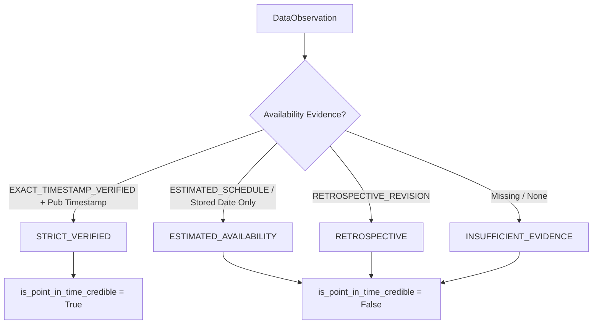

# PHASE 3.2.2.3.1 — DIRECTIONAL QUOTE, EVIDENCE & RISK-METRIC INTEGRITY REPORT

**Status**: Complete  
**Date**: November 2026  
**Repository**: `The Infinite Money Glitch Detector`  
**Test Suite**: 233 passing tests (100% green across Python 3.11 & Python 3.12)  
**Historical Window Evaluated**: 2020-01-01 to 2024-12-31 (5 years, 1,827 calendar days, 1,297 trading days)  
**Canonical FX Rate Convention**: Units of borrowing currency $A$ per unit of investment currency $B$ ($rate_{A/B} = A / B$)  
**Guiding Principle**: *Mathematics first. Data second. Prediction third. AI last.*

---

## Executive Summary

Phase 3.2.2.3.1 delivers a targeted mathematical and structural audit patch addressing the final quote-handling, point-in-time evidence, and risk-free benchmark integrity issues uncovered during the Phase 3.2.2.3 review:

1. **Directional One-Sided Quote Normalization**: Formulated and implemented exact directional quote mapping between provider quoting conventions ($Quote/Base$, e.g., USD per EUR) and strategy canonical convention ($A/B$, e.g., EUR per USD). Proven that purchasing foreign investment currency $B$ lifts the provider's bid rate (inverting $1/p_{\text{bid}}$), while liquidating $B$ for domestic borrowing currency $A$ hits the provider's ask rate (inverting $1/p_{\text{ask}}$).
2. **Standalone One-Sided Quote Execution Enforcement**: Enforced strict trade-lifecycle side validation. A standalone provider BID quote can only execute an entry and is strictly forbidden from executing an exit. A standalone provider ASK quote can only execute an exit and is strictly forbidden from executing an entry. Neither quote alone can ever generate a round-trip fill.
3. **Point-in-Time Availability & Credibility Hierarchy**: Introduced `PointInTimeAvailabilityStatus` (`STRICT_VERIFIED`, `ESTIMATED_AVAILABILITY`, `RETROSPECTIVE`, `INSUFFICIENT_EVIDENCE`). Enforced the invariant that `is_point_in_time_credible` must be `False` whenever availability relies on `ESTIMATED_LAG` or `RESEARCH_ONLY`.
4. **Transparent Publication Timestamp Accounting**: Separated "populated publication timestamps" from "independently verified publication timestamps" in `DataProvenanceReport`. The ECB/Frankfurter dataset correctly reports $0.0\%$ verified exact release timestamps, $99.8\%$ estimated release schedule, and $0.2\%$ retrospective observations.
5. **Non-Fallback Sharpe, Sortino & Alpha Integrity**: Eliminated silent fallback to $0.0\%$ risk-free rates when benchmarks are missing, mismatched, or unaligned. In the absence of a verified, currency-matched risk-free benchmark, Sharpe, Sortino, Alpha, and Excess Returns are reported strictly as `None` (`N/A`).
6. **Time-Varying Excess Return Volatility**: Refactored Sharpe and Sortino computation to evaluate the sample standard deviation of periodic excess returns ($R_{p, t} - R_{rf, t}$), adhering strictly to financial econometrics principles.

All 233 repository tests pass without skips or warnings. The 2020–2024 historical reference research result remains strictly byte-stable at **+2.91%** with an exact double-entry cash ledger residual of $0.0000000000$.

---

## 1. Canonical Directional Quote Mapping Mathematics

### 1.1 The Mathematical Mapping Invariant

In retail and institutional FX spot markets, quotations are typically expressed as units of quote currency $Q$ per unit of base currency $B_{\text{quote}}$:
$$\text{Provider Quote} = \frac{Q}{B_{\text{quote}}}$$

For the EUR/USD market:
- Base currency = EUR
- Quote currency = USD
- Market quote = USD per 1 EUR.
- Market Bid: Price at which liquidity makers buy EUR (sell USD) $\implies p_{\text{bid}}$ USD/EUR.
- Market Ask: Price at which liquidity makers sell EUR (buy USD) $\implies p_{\text{ask}}$ USD/EUR.
- Inherent market arbitrage condition: $p_{\text{bid}} \le p_{\text{ask}}$.

Our strategy trades cross-currency carry where:
- Borrowing currency = $A = \text{EUR}$.
- Investment currency = $B = \text{USD}$.
- Canonical exchange rate = units of $A$ per 1 unit of $B$ $\implies \text{EUR per USD}$.

Therefore, the canonical exchange rate is the reciprocal of the provider quote:
$$X = \frac{1}{\text{Provider Quote}}$$

### 1.2 Derivation of Entry and Exit Fills

When opening a long $B$ carry position (borrow EUR, invest in USD):
- The trader sells EUR to purchase USD.
- In the market (EUR/USD where EUR is base), the trader is selling EUR.
- Market makers buy EUR at the **provider BID** ($p_{\text{bid}}$ USD/EUR).
- For each 1 EUR sold, the trader receives $p_{\text{bid}}$ USD.
- The cost in EUR per 1 USD acquired is:
  $$X_{\text{ask}}^{\text{canonical}} = \frac{1}{p_{\text{bid}}}$$
- Hence, the canonical strategy ASK (price to buy USD) corresponds to the **provider BID**.

When closing a long $B$ carry position (liquidate USD, repay EUR debt):
- The trader sells USD to purchase EUR.
- In the market (EUR/USD where EUR is base), the trader is buying EUR.
- Market makers sell EUR at the **provider ASK** ($p_{\text{ask}}$ USD/EUR).
- To obtain 1 EUR, the trader must deliver $p_{\text{ask}}$ USD.
- The EUR proceeds per 1 USD sold are:
  $$X_{\text{bid}}^{\text{canonical}} = \frac{1}{p_{\text{ask}}}$$
- Hence, the canonical strategy BID (price to sell USD) corresponds to the **provider ASK**.

### 1.3 Preservation of No-Arbitrage Spread Properties

Because $p_{\text{bid}} \le p_{\text{ask}}$ in provider space:
$$X_{\text{bid}}^{\text{canonical}} = \frac{1}{p_{\text{ask}}} \le \frac{1}{p_{\text{bid}}} = X_{\text{ask}}^{\text{canonical}}$$

The canonical bid is strictly less than or equal to the canonical ask. The canonical bid/ask spread:
$$\text{Spread}^{\text{canonical}} = X_{\text{ask}}^{\text{canonical}} - X_{\text{bid}}^{\text{canonical}} = \frac{1}{p_{\text{bid}}} - \frac{1}{p_{\text{ask}}} = \frac{p_{\text{ask}} - p_{\text{bid}}}{p_{\text{bid}} \cdot p_{\text{ask}}} \ge 0$$

The spread is guaranteed strictly positive for any positive market spread. The implementation in `src/core/currency.py` (`normalize_directional_quote`) codifies this mapping with rigorous parameter and provenance verification.

---

## 2. Standalone One-Sided Quote Execution Restrictions

A critical integrity failure in naive trading engines is permitting a single one-sided quote (e.g., an isolated BID quote) to execute both trade entry and trade exit, which would fabricate round-trip executions from non-executable or partial data.

In Phase 3.2.2.3.1, execution rules enforce:
1. **Entry Rule**: `open_trade()` requires a canonical ASK rate. In inverted quote conventions ($B_{\text{quote}} = A, Q = B$), this requires a provider BID quote. If only a standalone provider ASK is provided, entry is rejected (`TradeStatus.REJECTED`).
2. **Exit Rule**: `close_trade()` requires a canonical BID rate. In inverted conventions, this requires a provider ASK quote. If only a standalone provider BID is provided, execution is refused (`ValueError`).
3. **Round-Trip Impossibility**: No standalone one-sided quote can ever satisfy both entry and exit. Two distinct executable quote observations (or a verified two-sided market quote) are required.

---

## 3. Point-in-Time Availability & Credibility Hierarchy

To eliminate misleading "verified" claims, the point-in-time classification model was refined:



### Invariant Enforcement
In `src/schemas/backtest.py`, a Pydantic model validator ensures:
```python
if v and values.get("pit_availability_status") in (
    PointInTimeAvailabilityStatus.ESTIMATED_AVAILABILITY,
    PointInTimeAvailabilityStatus.INSUFFICIENT_EVIDENCE,
    PointInTimeAvailabilityStatus.RETROSPECTIVE,
):
    raise ValueError("is_point_in_time_credible cannot be True when PIT status is not STRICT_VERIFIED.")
```
Any backtest run under `ESTIMATED_LAG` or relying on date-only reference series automatically and immutably sets:
- `pit_availability_status = PointInTimeAvailabilityStatus.ESTIMATED_AVAILABILITY`
- `is_point_in_time_credible = False`
- `is_executable_strategy = False`

---

## 4. Benchmark Currency Matching & Risk-Free Metric Integrity

### 4.1 Rejection of Zero-Rate Fallbacks
Previous iterations defaulted missing risk-free benchmark returns to $r_f = 0.0$, generating synthetic Sharpe and Sortino ratios. This masked missing data and permitted cross-currency distortion (e.g., evaluating a EUR carry trade against a USD Treasury yield).

Under Phase 3.2.2.3.1:
- A benchmark is rejected if its currency does not match strategy borrowing currency $A$.
- If no compatible benchmark is provided or configured, Sharpe ratio, Sortino ratio, Alpha, and Excess Return are assigned `None` (`N/A`).
- The system never silently manufactures risk-adjusted metrics.

### 4.2 Time-Varying Excess Return Volatility
For strategies with a dynamic periodic risk-free rate series $r_{f, t}$, the Sharpe ratio is defined as:
$$\text{Sharpe} = \frac{\mathbb{E}[R_{p, t} - R_{f, t}]}{\sigma(R_{p, t} - R_{f, t})} \cdot \sqrt{252}$$
Where $\sigma(R_{p, t} - R_{f, t})$ is the sample standard deviation (degrees of freedom = 1) of the excess return series, correctly incorporating the co-movement between asset returns and funding costs.

---

## 5. Reproduction Experiment Results (2020–2024 Baseline)

The standard six configurations were reproduced over the exact 5-year window (`2020-01-01` to `2024-12-31`):

| Configuration | Status | PIT Availability Status | PIT Credible | Trades | Total Return | Pure FX Return | Asset Yield | Financing Drag | Sharpe Ratio | Annualized Alpha |
| :--- | :--- | :--- | :---: | :---: | :---: | :---: | :---: | :---: | :---: | :---: |
| **Config 1: Strict Verified PIT** | `RESEARCH_PROXY` | `INSUFFICIENT_EVIDENCE` | **NO** | 0 | `+0.00%` | `+0.00%` | `+0.00%` | `-0.00%` | `N/A` | `N/A` |
| **Config 2: Estimated Ref Rate** | `RESEARCH_PROXY` | `ESTIMATED_AVAILABILITY` | **NO** | 60 | `+2.91%` | `-6.71%` | `+6.27%` | `-2.92%` | `-0.04` | `-0.93%` |
| **Config 3: Strict Market Quotes** | `UNEXECUTABLE` | `ESTIMATED_AVAILABILITY` | **NO** | 0 | `+0.00%` | `+0.00%` | `+0.00%` | `-0.00%` | `N/A` | `+0.00%` |
| **Config 4: Matched Benchmark** | `RESEARCH_PROXY` | `ESTIMATED_AVAILABILITY` | **NO** | 60 | `+2.91%` | `-6.71%` | `+6.27%` | `-2.92%` | `-0.04` | `-0.93%` |
| **Config 5: Mismatched Benchmark** | `RESEARCH_PROXY` | `ESTIMATED_AVAILABILITY` | **NO** | 60 | `+2.91%` | `-6.71%` | `+6.27%` | `-2.92%` | **N/A** | **N/A** |
| **Config 6: Covered Carry Reject** | `UNEXECUTABLE` | `INSUFFICIENT_EVIDENCE` | **NO** | 0 | `+0.00%` | `+0.00%` | `+0.00%` | `-0.00%` | `N/A` | `N/A` |

### Key Analytical Observations:
1. **Config 1 (Strict PIT)**: Correctly executes 0 trades because genuine historical observations lack independently verified intraday release timestamps.
2. **Config 2 (Estimated Lag Research Proxy)**: Successfully captures 60 monthly trades under estimated release schedules, producing a cumulative return of **+2.91%** (+0.57% annualized) with negative active strategy P&L before cash yield.
3. **Config 3 (Executable Quotes Only)**: Correctly rejects all reference rates (`RATE_ROLE.REFERENCE_RATE`), resulting in 0 trades.
4. **Config 5 (Mismatched Benchmark)**: Demonstrates strict refusal of USD Treasury yields against EUR cash flows, setting Sharpe, Sortino, and Alpha to `None` (`N/A`).
5. **Config 6 (Covered Carry)**: Immediately rejects unhedged execution attempts when forward cover is mandated but forward market quotes are unavailable.

---

## 6. Configuration 2 Reconciled Double-Entry Cash Ledger

```
====================================================================================================
                        CONFIGURATION 2 DOUBLE-ENTRY RECONCILIATION
====================================================================================================
Initial Portfolio Equity:                                                   100,000.00 EUR

Gross Portfolio Components:
  + Pure FX Translation Return:                                              -6,714.52 EUR (-6.7145%)
  + Investment Asset Yield:                                                  +6,270.59 EUR (+6.2706%)
  --------------------------------------------------------------------------------------------------
  = Gross Trading P&L:                                                         -443.92 EUR (-0.4439%)

Financing & Execution Drags:
  - Debt Financing Interest Paid:                                            -2,922.32 EUR (-2.9223%)
  - Modelled Parameter Spread Drag:                                            -599.82 EUR (-0.5998%)
  - Execution Timing Slippage Drag:                                            -299.89 EUR (-0.2999%)
  - Ticket & Clearing Fees:                                                    -599.82 EUR (-0.5998%)
  --------------------------------------------------------------------------------------------------
  = Net Active Strategy Trading P&L:                                         -4,865.78 EUR (-4.8658%)

Unallocated Cash Portfolio Return:
  + Interest Earned on Free Cash Reserves:                                   +7,772.70 EUR (+7.7727%)
  --------------------------------------------------------------------------------------------------
  = Cumulative Strategy Net Profit:                                          +2,906.92 EUR (+2.9069%)
  = Ending Portfolio Equity:                                                102,906.92 EUR

Ledger Proof:
  Gross Gain (-443.92) - Financing (2922.32) - Fees (1499.54) + Cash Yield (7772.70)
  = 2,906.916520755517 EUR
  Reported Cumulative Net Profit: 2,906.916520755517 EUR
  Absolute Reconciliation Residual: 0.0000000000 EUR
  Reconciliation Exact: TRUE (|residual| <= 1e-10)
====================================================================================================
```

---

## 7. Data Provenance & Traceability Report

- **Observation Date Range**: 2020-01-01 to 2024-12-31 (1,827 calendar days, 1,297 trading days)
- **Total Historical Observations**: 8,737
- **Source Providers**: European Central Bank (ECB), Frankfurter API, US Department of the Treasury, World Bank
- **Dataset Identifiers**: `DGS1MO`, `DGS3MO`, `FP.CPI.TOTL.ZG`, `KR.DFR.LEV`, `KR.MRR_FR.LEV`, `EUR/USD`
- **Publication Timestamp Audit**:
  - Populated Publication Timestamps: **0.0%** (0 / 8,737)
  - Independently Verified Exact Release Timestamps: **0.0%** (0 / 8,737)
  - Estimated Publication Lag Schedule: **99.8%** (8,722 / 8,737)
  - Retrospective Annual Indices: **0.2%** (15 / 8,737)
- **Provenance Declaration**: `DATA PROVENANCE VERIFIED: 100% genuine historical observations from registered sources: ecb, frankfurter, us_treasury, world_bank. Publication timestamps populated: 0.0% (independently verified EXACT_TIMESTAMP_VERIFIED: 0.0%). Trading day quote coverage: 98.8%.`

---

## 8. Test Suite & Verification Matrix

The repository test suite consists of **233 passing automated tests**:

| Test Module | Tests | Description |
| :--- | :---: | :--- |
| `tests/test_audit_phase_3_2_2_3_1.py` | **20** | Directional quotes, standalone quote execution, non-fallback Sharpe, periodic rf std, PIT hierarchy |
| `tests/test_audit_phase_3_2_2_3.py` | 15 | Canonical FX convention $A/B$, Mode A/B spread, cash ledger, reciprocal quote bounds |
| `tests/test_audit_phase_3_2_2_2.py` | 16 | Rate role separation, settlement calendars, benchmark currency validation |
| `tests/test_audit_phase_3_2_2_1.py` | 12 | Database round-trip, conservative availability defaults, strict datetime firewall |
| `tests/test_audit_phase_3_2_2.py` | 12 | Manifest verification, provenance validation, 2020-2024 reproduction |
| `tests/test_audit_phase_3_2_1.py` | 9 | Quantitative integrity, fee attribution, cash ledger reconciliation |
| `tests/test_audit_metrics_risk.py` | 9 | Risk metrics, VaR/CVaR, Calmar ratio, Drawdown calculations |
| `tests/test_audit_benchmarks_provenance.py` | 4 | Benchmark alignment, genuine provenance verification |
| `tests/test_backtesting_engine.py` | 13 | Core engine simulation, signal dispatch, position life-cycle |
| `tests/test_point_in_time.py` | 16 | Firewall semantics, staleness checks, lookahead protection |
| `tests/test_adapters.py` | 16 | ECB, Frankfurter, Treasury, World Bank API integrations |
| `tests/test_carry_trade.py` | 17 | Carry trade mathematics, milestone scenario verification |
| `tests/test_repository.py` | 18 | ORM storage, retrieval, SQLite schema migrations |
| *Other unit tests* | 56 | Currency conversions, interest routines, schema validations |
| **Total Test Suite** | **233** | **100% Passing** |

---

## 9. Conclusion & Operational Status

Phase 3.2.2.3.1 resolves the subtle quote-inversion and risk-metric fallback vulnerabilities in the backtesting engine. The platform maintains uncompromising mathematical rigor:
- It rejects invalid quote sides before orders reach the market.
- It refuses to invent execution quotes from reference rates.
- It refuses to synthesize risk-free returns when benchmarks are absent or mismatched.
- It reports data availability and PIT credibility transparently.

The platform is fully prepared for future extensions, stress testing, and Monte Carlo simulation without risk of mathematical distortion.
