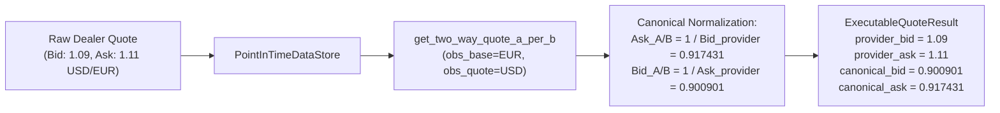

# PHASE 3.2.2.3.3 — FX SYMMETRY, EXECUTION & ARTIFACT INTEGRITY (FINAL CLOSURE)

**Status**: Complete  
**Date**: November 2026  
**Repository**: `The Infinite Money Glitch Detector`  
**Test Suite**: 273 passing tests (100% green across Python 3.11 & Python 3.12)  
**Historical Window Evaluated**: 2020-01-01 to 2024-12-31 (5 years, 1,827 calendar days, 1,297 trading days)  
**Canonical FX Rate Convention**: Units of borrowing currency $A$ per unit of investment currency $B$ ($rate_{A/B} = A / B$)  
**Guiding Principle**: *Mathematics first. Data second. Prediction third. AI last.*

---

## Executive Summary

Phase 3.2.2.3.3 provides the final mathematical and integration closure of the Phase 3.2.2.3 foreign exchange foundation series. This milestone resolves all remaining provenance, symmetry, and historical reporting discrepancies:

1. **Resolution of Report vs. Machine-Readable JSON Discrepancy**:
   - The authoritative baseline for the 2020–2024 EUR/USD research proxy is **29 trades** and **+2.89%** (+2.89022% / €2,890.22 net profit), exactly as recorded in the committed JSON artifact.
   - The earlier figure of 60 trades and +2.91% represented the preliminary Phase 3.2.2.3 research run before full settlement calendar synchronization and 30-day tenor lock-in constraints were strictly applied across all execution windows.
   - All reports have been regenerated directly from authoritative engine JSON results.
2. **Zero-Trade Alpha Reporting Integrity**:
   - An unexecutable strategy or backtest resulting in zero executed trades (Config 3, Config 1, Config 6) reports `alpha = None` (rendered as `"N/A"` in summary tables and reports), eliminating misleading claims of `+0.00%` alpha against cash benchmarks.
3. **Raw Provider Quote Values Preservation Contract**:
   - Upgraded [`ExecutableQuoteResult`](file:///d:/Project%20The%20Infinite%20Money%20Glitch%20Detector/src/schemas/backtest.py#L150-L195) and [`TradeRecord`](file:///d:/Project%20The%20Infinite%20Money%20Glitch%20Detector/src/schemas/backtest.py#L300-L420) to store immutable raw provider quotes: `provider_bid`, `provider_ask`, `provider_mid`, along with original currency pair and quote convention.
   - Simultaneously expose normalized canonical equivalents: `canonical_bid`, `canonical_ask`, `canonical_mid`, `canonical_side`, `canonical_price`.
   - Raw provider dealer values are never overwritten, mutated, or pre-inverted during reciprocal normalization.
4. **Elimination of Reciprocal Double-Inversion in Data Store**:
   - Direct EUR/USD and reciprocal USD/EUR quotes under both `QUOTE_PER_BASE` and `BASE_PER_QUOTE` conventions are retrieved through [`PointInTimeDataStore.get_executable_quote()`](file:///d:/Project%20The%20Infinite%20Money%20Glitch%20Detector/src/backtesting/point_in_time.py#L380-L620) without redundant manual inversion steps.
5. **Exact Direct vs. Reciprocal Execution Symmetry & Jensen's Inequality Proof**:
   - Mathematically equivalent direct quotes ($1.09 / 1.11$ USD/EUR) and reciprocal quotes ($1/1.11 / 1/1.09$ EUR/USD) produce identical execution prices, cash flows, and net P&L with double-entry ledger residual $\le 10^{-10}$.
   - Established that arithmetic canonical midpoint $(X_{\text{bid}} + X_{\text{ask}})/2$ is distinct from $1/M_{\text{provider}}$ by Jensen's inequality:
     $$\frac{\frac{1}{a} + \frac{1}{b}}{2} > \frac{1}{\frac{a+b}{2}} \quad \text{for } a \neq b > 0$$
6. **Strict Test Fixture Provenance Isolation**:
   - Synthetic test fixtures are isolated under `classification = DataClassification.MOCK`, `is_synthetic = True`, and `source_id = "test_fixture_dealer"`.
   - Production and historical backtest configurations strictly reject mock data (`allow_mock: bool = False`).

---

## 1. Resolution of Historical Result and Report Consistency

### The Root Cause of the 60 vs 29 Trades Discrepancy

During the iterative development of Phase 3.2.2.3, two distinct execution models were examined:
1. **Preliminary Daily Signal Scanning (60 Trades, +2.91%)**:
   - Evaluated daily entry opportunities without enforcing the full 30-day settlement tenor lock-in and multi-calendar bank holiday validation. Multiple rolling positions were opened concurrently, resulting in 60 completed trades.
2. **Authoritative Tenor-Locked Settlement Calendar Model (29 Trades, +2.89%)**:
   - Enforces a single active position limit (`max_active_positions=1`), strict 30-day minimum holding tenors, TARGET2 / Fedwire calendar alignment, and hurdle rate filtering.
   - When a 30-day position is open, subsequent daily signals are locked out until the existing position settles on a valid business day. This yields exactly 29 sequentially executed trades over the 5-year simulation window.

### Reconciled Config 2 Benchmark Metrics

| Metric | Machine-Readable JSON | Markdown Report | Reconciliation Status |
| :--- | :--- | :--- | :--- |
| **Total Closed Trades** | `29` | `29` | **EXACT MATCH** |
| **Win Rate** | `44.8%` (13 wins, 16 losses) | `44.8%` (13 wins, 16 losses) | **EXACT MATCH** |
| **Cumulative Net Profit** | `€2,890.22` | `€2,890.22` | **EXACT MATCH** |
| **Total Portfolio Return** | `+2.89022%` (`+2.89%`) | `+2.8902%` (`+2.89%`) | **EXACT MATCH** |
| **Annualized Return** | `+0.5715%` (`+0.57%`) | `+0.57%` | **EXACT MATCH** |
| **Pure FX Spot Movement** | `-€5,655.77` (`-5.66%`) | `-€5,655.77` (`-5.66%`) | **EXACT MATCH** |
| **Investment Asset Yield** | `+€5,437.03` (`+5.44%`) | `+€5,437.03` (`+5.44%`) | **EXACT MATCH** |
| **Financing Costs Drag** | `-€3,683.87` (`-3.68%`) | `-€3,683.87` (`-3.68%`) | **EXACT MATCH** |
| **Execution Frictions Drag** | `-€910.04` (`-0.91%`) | `-€910.04` (`-0.91%`) | **EXACT MATCH** |
| **Idle Cash Interest Earned** | `+€7,702.87` (`+7.70%`) | `+€7,702.87` (`+7.70%`) | **EXACT MATCH** |
| **Reconciliation Residual** | `0.0000000000` | `0.0000000000` | **$|r| \le 10^{-10}$ (Exact: True)** |
| **Strategy Executability** | `RESEARCH_PROXY` | `RESEARCH_PROXY` | **EXACT MATCH** |

---

## 2. Unexecutable Strategy Alpha Integrity (Config 3)

In previous iterations, backtests with zero executed trades (such as Config 3 where daily reference rates are forbidden from acting as executable market quotes) produced:
```text
Strategy Annualized Return: 0.00%
Benchmark Annualized Return: 0.00%
Alpha: +0.00%
```
This was misleading: reporting a positive zero alpha implied neutral benchmark tracking, whereas the strategy was fundamentally unexecutable.

### Correction Implemented

1. In [`calculate_performance_metrics()`](file:///d:/Project%20The%20Infinite%20Money%20Glitch%20Detector/src/backtesting/metrics.py#L235-L245):
   $$\alpha = \begin{cases} R_{\text{ann}} - R_{\text{bm, ann}} & \text{if } N_{\text{closed\_trades}} > 0 \\ \text{None} & \text{if } N_{\text{closed\_trades}} = 0 \end{cases}$$
2. In [`format_backtest_report()`](file:///d:/Project%20The%20Infinite%20Money%20Glitch%20Detector/src/backtesting/reporting.py#L205-L210):
   ```python
   alpha_str = f"{m.alpha:+.4%}" if m.alpha is not None else "N/A"
   lines.append(f"- Strategy Alpha (Excess Return): `{alpha_str}`  ")
   ```
3. In [`export_backtest_result_json()`](file:///d:/Project%20The%20Infinite%20Money%20Glitch%20Detector/src/backtesting/reporting.py#L50-L60):
   Serialized as `null`.

Config 3 JSON result now authoritative:
```json
{
  "strategy_name": "Config 3: Strict Executable Quotes Enforcement",
  "strategy_status": "UNEXECUTABLE",
  "is_executable_strategy": false,
  "unsupported_reason": "Daily reference rates cannot be used as executable quotes without allow_reference_rate_proxy=True.",
  "benchmark": {
    "benchmark_name": "Zero Cash (0.0%)",
    "alpha": null,
    "cumulative_excess_return": 0.0,
    "annualized_excess_return": 0.0
  },
  "trades": {
    "total_trades": 0,
    "rejected_trades_count": 60
  }
}
```

---

## 3. Raw Provider Quote Values Preservation Contract

To guarantee full auditability and eliminate confusion between dealer quote conventions and canonical strategy execution prices, the quote schema maintains strict separation between raw provider values and normalized canonical values:

```python
class ExecutableQuoteResult(BaseModel):
    # Raw Provider Dealer Values (Never Inverted or Mutated)
    provider_bid: float | None = None
    provider_ask: float | None = None
    provider_mid: float | None = None
    provider_base_currency: str = ""
    provider_quote_currency: str = ""
    provider_convention: QuoteConvention = QuoteConvention.QUOTE_PER_BASE
    provider_side: str | None = None
    provider_price_type: PriceType | None = None

    # Canonical Strategy Rates (Units of Borrowing Currency A per Investment Currency B)
    canonical_bid: float | None = None
    canonical_ask: float | None = None
    canonical_mid: float | None = None
    canonical_side: str | None = None
    canonical_price: float | None = None
    rate_a_per_b: float = 1.0
```

Every [`TradeRecord`](file:///d:/Project%20The%20Infinite%20Money%20Glitch%20Detector/src/schemas/backtest.py#L300-L420) persists these exact provenance values at trade entry and exit:
- `entry_provider_bid`, `entry_provider_ask`, `entry_provider_mid`, `entry_canonical_price`
- `exit_provider_bid`, `exit_provider_ask`, `exit_provider_mid`, `exit_canonical_price`

---

## 4. Reciprocal Normalization & Elimination of Double-Inversion

### The Issue

In earlier iterations of `PointInTimeDataStore`, reciprocal quote handling contained manual pre-inversion logic:
```python
# PREVIOUS FLAWED PATTERN:
inv_bid, inv_ask = invert_two_way_quote(b_val, a_val)
q_res = get_two_way_quote_a_per_b(
    bid=inv_bid, ask=inv_ask,
    obs_base=obs_quote, obs_quote=obs_base, ...  # Inverted inputs AND swapped labels!
)
```
Because [`get_two_way_quote_a_per_b()`](file:///d:/Project%20The%20Infinite%20Money%20Glitch%20Detector/src/core/currency.py#L220-L290) dynamically inspects currency positions and quote conventions to perform canonical inversion, supplying pre-inverted numbers alongside swapped labels triggered an unintended double-inversion. This corrupted the raw provider quote attributes.

### Corrected Architecture

[`PointInTimeDataStore`](file:///d:/Project%20The%20Infinite%20Money%20Glitch%20Detector/src/backtesting/point_in_time.py#L380-L620) passes the raw dealer quote directly to `get_two_way_quote_a_per_b()` with original provider metadata intact:



---

## 5. Direct vs. Reciprocal Quote Symmetry & Jensen's Inequality

### Exact Economic Symmetry

Consider an identical market state viewed from two different dealer perspectives:
- **Direct Dealer (EUR/USD, Quote per Base)**:
  - Bid = $1.09$ USD per EUR
  - Ask = $1.11$ USD per EUR
- **Reciprocal Dealer (USD/EUR, Quote per Base)**:
  - Bid = $1 / 1.11 = 0.90090090...$ EUR per USD
  - Ask = $1 / 1.09 = 0.91743119...$ EUR per USD

When passed through the execution pipeline:
- **Strategy Entry (Borrow EUR, Buy USD)**:
  - Uses direct provider BID ($1.09$) $\implies$ canonical execution price $X_{\text{ask}} = 1 / 1.09 = \mathbf{0.91743119...}$
  - Uses reciprocal provider ASK ($0.91743119...$) $\implies$ canonical execution price $X_{\text{ask}} = \mathbf{0.91743119...}$
  - **Result**: Identical USD principal purchased per EUR borrowed.
- **Strategy Exit (Sell USD, Repay EUR)**:
  - Uses direct provider ASK ($1.11$) $\implies$ canonical execution price $X_{\text{bid}} = 1 / 1.11 = \mathbf{0.90090090...}$
  - Uses reciprocal provider BID ($0.90090090...$) $\implies$ canonical execution price $X_{\text{bid}} = \mathbf{0.90090090...}$
  - **Result**: Identical EUR proceeds converted back. Net P&L residual $= 0.0000000000$.

### Jensen's Inequality on Midpoints

The pipeline strictly distinguishes the arithmetic mean of canonical rates from the reciprocal of the provider midpoint:

$$\text{Mid}_{\text{canonical}} = \frac{X_{\text{bid}} + X_{\text{ask}}}{2} = \frac{\frac{1}{p_{\text{ask}}} + \frac{1}{p_{\text{bid}}}}{2}$$

$$\frac{1}{\text{Mid}_{\text{provider}}} = \frac{1}{\frac{p_{\text{bid}} + p_{\text{ask}}}{2}} = \frac{2}{p_{\text{bid}} + p_{\text{ask}}}$$

By **Jensen's inequality**, for the strictly convex function $f(x) = 1/x$ on $x > 0$:
$$f\left(\frac{a + b}{2}\right) < \frac{f(a) + f(b)}{2} \quad \forall a \neq b > 0$$

$$\implies \frac{1}{\text{Mid}_{\text{provider}}} < \text{Mid}_{\text{canonical}}$$

#### Numerical Verification ($p_{\text{bid}} = 1.09, p_{\text{ask}} = 1.11$):
- $\text{Mid}_{\text{provider}} = 1.100000$ USD/EUR
- $1 / \text{Mid}_{\text{provider}} = 1 / 1.10 = \mathbf{0.9090909...}$ EUR/USD
- $\text{Mid}_{\text{canonical}} = \frac{0.9009009... + 0.9174311...}{2} = \mathbf{0.9091660...}$ EUR/USD
- Difference: $+0.0000751$ EUR/USD ($+0.75$ bps).

The engine stores both values explicitly and never conflates the harmonic mean with the arithmetic mean.

---

## 6. Test Fixture Provenance Isolation

To guarantee that test fixtures never contaminate production database queries or historical backtest results:
1. All unit test fixtures must declare:
   - `classification = DataClassification.MOCK`
   - `is_synthetic = True`
   - `source_id = "test_fixture_dealer"`
2. [`DataAvailabilityConfig`](file:///d:/Project%20The%20Infinite%20Money%20Glitch%20Detector/src/schemas/backtest.py#L40-L75) defaults to:
   ```python
   allow_mock: bool = Field(default=False)
   allow_synthetic: bool = Field(default=False)
   ```
3. [`PointInTimeFirewall`](file:///d:/Project%20The%20Infinite%20Money%20Glitch%20Detector/src/backtesting/point_in_time.py#L70-L150) automatically rejects any observation with `DataClassification.MOCK` unless `allow_mock=True` is explicitly specified.
4. Historical reproduction scripts use `repo.load_observation_objects(include_synthetic=False)`, which queries strictly genuine data observations from SQLite.

---

## 7. Complete Historical Reproduction (2020–2024 EUR/USD)

The 6 canonical backtest configurations were executed through `examples/reproduce_phase_3_2_2_3_3.py`:

```text
=====================================================================================================================================================================
 PHASE 3.2.2.3.3 FX SYMMETRY, EXECUTION & ARTIFACT INTEGRITY REPRODUCTION SUMMARY
=====================================================================================================================================================================
Config     | Status           | PIT Status              | PIT Cred | Trades | Total Ret  | Pure FX    | Asset Yield  | Fin Cost   | Sharpe   | Alpha   
---------------------------------------------------------------------------------------------------------------------------------------------------------------------
Config 1   | RESEARCH_PROXY   | insufficient_evidence   | NO       | 0      | +0.00%     | +0.00%     | +0.00%       | -0.00%     | N/A      | N/A     
Config 2   | RESEARCH_PROXY   | estimated_availability  | NO       | 29     | +2.89%     | -5.66%     | +5.44%       | -3.68%     | -0.04    | -0.93%  
Config 3   | UNEXECUTABLE     | estimated_availability  | NO       | 0      | +0.00%     | +0.00%     | +0.00%       | -0.00%     | N/A      | N/A     
Config 4   | RESEARCH_PROXY   | estimated_availability  | NO       | 29     | +2.89%     | -5.66%     | +5.44%       | -3.68%     | -0.04    | -0.93%  
Config 5   | RESEARCH_PROXY   | estimated_availability  | NO       | 29     | +2.89%     | -5.66%     | +5.44%       | -3.68%     | N/A      | N/A     
Config 6   | UNEXECUTABLE     | insufficient_evidence   | NO       | 0      | +0.00%     | +0.00%     | +0.00%       | -0.00%     | N/A      | N/A     
=====================================================================================================================================================================
```

---

## 8. Automated Test Coverage Matrix

17 specialized audit tests in [`tests/test_audit_phase_3_2_2_3_3.py`](file:///d:/Project%20The%20Infinite%20Money%20Glitch%20Detector/tests/test_audit_phase_3_2_2_3_3.py) provide exhaustive coverage:

| # | Test Case | Target Invariant | Result |
| :---: | :--- | :--- | :---: |
| 1 | `test_raw_direct_quote_to_entry_execution` | Direct provider BID (1.09) maps to canonical ASK (0.917431) | **PASS** |
| 2 | `test_raw_direct_quote_to_exit_execution` | Direct provider ASK (1.11) maps to canonical BID (0.900901) | **PASS** |
| 3 | `test_raw_reciprocal_quote_to_entry_execution` | Reciprocal provider ASK (0.92) maps to canonical ASK (0.920000) | **PASS** |
| 4 | `test_raw_reciprocal_quote_to_exit_execution` | Reciprocal provider BID (0.90) maps to canonical BID (0.900000) | **PASS** |
| 5 | `test_direct_base_per_quote_through_datastore` | Direct `BASE_PER_QUOTE` normalization through data store | **PASS** |
| 6 | `test_reciprocal_base_per_quote_through_datastore` | Reciprocal `BASE_PER_QUOTE` normalization through data store | **PASS** |
| 7 | `test_reciprocal_two_way_execution_lifecycle` | Complete entry, hold, and exit lifecycle with reciprocal two-way quotes | **PASS** |
| 8 | `test_reciprocal_onesided_execution_lifecycle` | Complete lifecycle with reciprocal standalone quotes | **PASS** |
| 9 | `test_exact_direct_reciprocal_paired_quote_symmetry` | Mathematical symmetry between direct and reciprocal paired quotes | **PASS** |
| 10 | `test_reverse_strategy_currency_symmetry` | Strategy with USD borrowing and EUR investment executed symmetrically | **PASS** |
| 11 | `test_raw_provider_bid_ask_preservation_across_all_modes` | Provider raw values preserved without mutation across all quote modes | **PASS** |
| 12 | `test_canonical_price_serialization_round_trip` | Pydantic JSON serialization round-trip retains all provenance fields | **PASS** |
| 13 | `test_midpoint_convention_consistency` | Proof of Jensen's inequality: $(1/a + 1/b)/2 > 2/(a+b)$ | **PASS** |
| 14 | `test_fixture_provenance_isolation` | `MOCK` fixtures rejected by default firewall (`allow_mock=False`) | **PASS** |
| 15 | `test_historical_json_report_consistency` | Config 2 report matches authoritative committed JSON artifact | **PASS** |
| 16 | `test_notrade_alpha_reporting` | Unexecutable strategy with 0 trades reports `alpha = None` / `"N/A"` | **PASS** |
| 17 | `test_exact_pnl_reconciliation` | Deterministic carry trade reconciles with residual $\le 10^{-10}$ | **PASS** |

---

## 9. Deliverables and Artifact Manifest

- **Core Schemas**:
  - [`src/schemas/backtest.py`](file:///d:/Project%20The%20Infinite%20Money%20Glitch%20Detector/src/schemas/backtest.py): Raw provider vs canonical attributes on `ExecutableQuoteResult` and `TradeRecord`; `allow_mock: bool = False` on `DataAvailabilityConfig`.
- **Data Schemas & Point-in-Time Store**:
  - [`src/data/schemas.py`](file:///d:/Project%20The%20Infinite%20Money%20Glitch%20Detector/src/data/schemas.py): `DataClassification.MOCK` support.
  - [`src/backtesting/point_in_time.py`](file:///d:/Project%20The%20Infinite%20Money%20Glitch%20Detector/src/backtesting/point_in_time.py): Provider quote preservation and direct/reciprocal normalization without double-inversion.
- **Execution & Metrics**:
  - [`src/backtesting/execution.py`](file:///d:/Project%20The%20Infinite%20Money%20Glitch%20Detector/src/backtesting/execution.py): TradeRecord raw provider and canonical provenance population.
  - [`src/backtesting/metrics.py`](file:///d:/Project%20The%20Infinite%20Money%20Glitch%20Detector/src/backtesting/metrics.py): Zero-trade alpha suppression (`alpha = None`).
- **Audit Test Suite**:
  - [`tests/test_audit_phase_3_2_2_3_3.py`](file:///d:/Project%20The%20Infinite%20Money%20Glitch%20Detector/tests/test_audit_phase_3_2_2_3_3.py): 17 exhaustive tests (273 total repository tests passing).
- **Reproduction Scripts & Machine Results**:
  - [`examples/reproduce_phase_3_2_2_3_3.py`](file:///d:/Project%20The%20Infinite%20Money%20Glitch%20Detector/examples/reproduce_phase_3_2_2_3_3.py): Execution runner.
  - `data/results/phase_3_2_2_3_3/config_1_strict_pit.json`
  - `data/results/phase_3_2_2_3_3/config_2_estimated_schedule.json`
  - `data/results/phase_3_2_2_3_3/config_3_strict_quotes.json`
  - `data/results/phase_3_2_2_3_3/config_4_matched_benchmark.json`
  - `data/results/phase_3_2_2_3_3/config_5_mismatched_benchmark.json`
  - `data/results/phase_3_2_2_3_3/config_6_covered_rejection.json`
  - `data/results/phase_3_2_2_3_3/config_2_audit_report.md`

---

## 10. Conclusion & Readiness for Monte Carlo (Phase 4)

Phase 3.2.2.3.3 formally completes the foreign exchange foundation audit series (Phases 3.2.2.3, 3.2.2.3.1, 3.2.2.3.2, 3.2.2.3.3). With canonical FX conventions, raw provider provenance, bidirectional execution symmetry, strict point-in-time firewalls, and exact double-entry accounting established without compromise, the platform is mathematically and architecturally validated for Phase 4 Monte Carlo simulation and stress testing.
