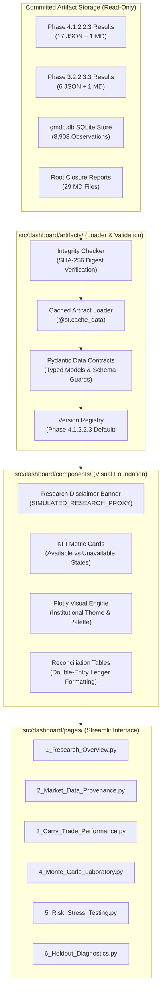
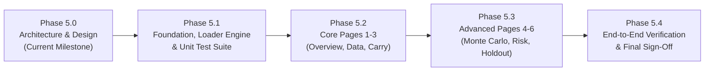

# Phase 5.0 — Research Dashboard Foundation & Architecture Specification

**Project:** The Infinite Money Glitch Detector  
**Milestone:** Phase 5.0 (Foundation & Architecture)  
**Baseline HEAD:** `b2d346a976bc22c5faf6faab8924731e84db440a`  
**Previous Milestone:** Phase 4.1.2.2.3.10 — COMPLETE (1,020 passed tests)  
**Guiding Principle:** Mathematics first. Data second. Prediction third. AI last.  
**Date:** 2026-11-09  

---

## 1. Executive Summary & Foundational Principles

Phase 5 transitions The Infinite Money Glitch Detector from a script- and report-driven quantitative research engine into an interactive, read-only exploratory dashboard powered by **Streamlit** and **Plotly**.

The purpose of the dashboard is to make the extensive historical backtesting (Phase 3) and Monte Carlo simulation/stress testing (Phase 4) outputs interpretable, transparent, and navigable for researchers, quantitative auditors, and risk officers.

### Non-Negotiable Core Tenets

1. **Strictly Read-Only (Single Source of Truth)**:
   - The dashboard is a visualization and reporting interface for *existing, committed research artifacts*.
   - The dashboard **never** invokes the mathematical engine (`calculate_carry_trade`), the backtester (`PointInTimeBacktestEngine`), or the simulation engine (`MonteCarloEngine`) at runtime.
   - Zero backtests, zero calibrations, zero Monte Carlo path generations occur during dashboard execution. Flashy visuals must never drift from audited, committed arithmetic.
2. **Cryptographic & Artifact Traceability**:
   - Every quantitative metric, table entry, and chart trace rendered in the UI must trace directly back to an authoritative JSON or Markdown artifact under `data/results/` or the SQLite archive `data/processed/gmdb.db`.
   - Every loaded artifact is validated against its expected SHA-256 digest and parsed through strict Pydantic schemas.
3. **Honest Reporting of Limitations (Zero Fabrication)**:
   - Simulated research results are **never** labeled as live trading returns or validated investment recommendations.
   - When an empirical or strategy holdout metric does not exist (such as the 2024 portfolio holdout), the dashboard explicitly renders a standardized **`UNAVAILABLE`** state with verbatim rationale, rather than substituting synthetic, zero, or interpolated data.
4. **Preservation of Research Classifications**:
   - Prominent tags enforce `SIMULATED_RESEARCH_PROXY` data classification and `ESTIMATED_LAG` point-in-time availability mode across all pages.
   - The mathematical parity tolerance ($\le 10^{-9}$) verified across Phases 4.1.2.2.3 through 4.1.2.2.3.10 is rigorously documented and maintained.

---

## 2. Workstream A: Authoritative Research Artifact Inventory

An exhaustive audit of committed research artifacts under `data/results/` and data stores under `data/` was conducted to establish the definitive catalog of inputs for the Phase 5 dashboard.

### 2.1 Authoritative Phase 4.1.2.2.3 Artifacts (Primary Simulation & Holdout Baseline)

Directory: `data/results/phase_4_1_2_2_3/`

| Artifact File | Size (Bytes) | SHA-256 Digest | Schema Type / Key Fields | Primary Dashboard Destination | Status |
|---|---|---|---|---|---|
| `calibration_report.json` | 5,576 | `a8994f4d70c6e5ecccd230fe91e41882f0a409da5fe33ef816dc1954ab6e3060` | Dict: `factor_names`, `covariance_matrix`, `correlation_matrix`, `factor_summaries`, `calibration_level_count` (990), `calibration_transition_count` (989) | Page 2 (Market Data), Page 4 (Monte Carlo) | Available |
| `factor_panel_manifest.json` | 3,038,862 | `f15aa918aff4a4dd11d65f4b90c487cbfb8ee5b64a307948f15df7ded873befe` | Dict: `factors` (4 series), `dates` (1,236 transitions), `level_dates` (1,237 levels), `raw_levels`, `values` | Page 2 (Market Data & Provenance) | Available |
| `model_comparison.json` | 6,820 | `5cc589f97423e8666aaa6434182b802dc8e918cc323d74502fe0982314aa4ea4` | List of 6 Model Dicts: `model_name`, `num_paths` (1000), `median_return`, `mean_return`, `prob_loss`, `var_95`, `cvar_95`, `max_drawdown_median` | Page 1 (Overview), Page 4 (Monte Carlo Lab) | Available |
| `gaussian_results.json` | 91,986 | `c342d16015f4e66dde68d2f77e2d7a8338826c232af122a526547c85dc90bb34` | Dict: `distribution_metrics` (quantiles p01-p99 for return, drawdown, equity), `representative_paths` (`worst`, `median`, `best`) | Page 4 (Monte Carlo Lab) | Available |
| `bootstrap_results.json` | 77,894 | `2f95dcf80ec095a1e39d2424e28c6598d5b71d2f10fbf9733b1e46bbd27d1eee` | Dict: Moving-Block Bootstrap (20-day block size), quantiles, representative paths | Page 4 (Monte Carlo Lab) | Available |
| `student_t_results.json` | 91,853 | `cc06de387576f71beecfc9f800cb2487b8bc06610074087ab34ae68413736bab` | Dict: Profile MLE Student-$t$ ($\hat{\nu} = 7.74$), fat-tail quantiles, representative paths | Page 4 (Monte Carlo Lab) | Available |
| `regime_results.json` | 103,756 | `a239aa72bc32470966c7ba566bc7718389dd641b63ce0396b9e5c7f4caa394d3` | Dict: 20th/80th volatility regime conditioning, quantiles, representative paths | Page 4 (Monte Carlo Lab) | Available |
| `convergence_report.json` | 8,009 | `bf14c44a7885afc26e5277de170890b0b1be8a4c74bd1763e7b58b8b7da7c614` | Dict: `checkpoints` (N=100, 250, 500, 750, 1000), `final_standard_error` (0.0142), stability flags | Page 4 (Monte Carlo Lab) | Available |
| `stress_test_results.json` | 14,130 | `4053f6596b8bb9aaa03373acca584fc60ebaf964e414b62acbfb4d343fe56348` | List of 19 Scenario Dicts: FX shocks, rate spikes, yield shifts, liquidity freezes, compound crises | Page 5 (Risk & Stress Testing) | Available |
| `correlation_stress_comparison.json` | 3,345 | `f1ec34a7a82db91f4b416b8eb5afe00a22e4af199c3b45cbb373c7ff1a5caf84` | Dict: CRN paired correlation breakdown ($\mathbf{R}_{\text{stressed}} = \mathbf{I}$), mean/median return delta, SE | Page 5 (Risk & Stress Testing) | Available |
| `funding_sensitivity.json` | 2,804 | `c85e8812a1bb0939ff187b49e7e063f49d0e19d22833ce3030e1ec4f0563d9d1` | Dict: Fixed vs Floating reset funding under 0, +100, +300, +500 bps borrowing shocks | Page 5 (Risk & Stress Testing) | Available |
| `holdout_diagnostics.json` | 1,856 | `822c9f4c772eec411cdd4a513f81228324e2f388a9f0a20513fdd11d4a9c5ef5` | Dict: 2024 Out-of-sample FX realized volatility (6.18%), ratio (0.773), KS test ($p=0.0559$), correlation shifts | Page 6 (Holdout Diagnostics) | Available |
| `factor_holdout_diagnostics.json` | 2,786 | `0e2b5fa1e7ddd3de28ebe997e4d9dcfc138356fc077a5d461770fbd96a9d143e` | Dict: 2024 Factor predictive quantiles, realized FX cumulative return (-5.98%, 22.9th percentile), drawdown | Page 6 (Holdout Diagnostics) | Available |
| `portfolio_holdout_diagnostics.json` | 758 | `0082f477222570c9ab5402f94e5d3f8c6d11bd04502106350e82d5378060be2d` | Dict: `status: UNAVAILABLE`, `is_available: false`, explicit reason string, zero simulated portfolio holdout metrics | Page 1 (Overview), Page 6 (Holdout Diagnostics) | **UNAVAILABLE** (Explicit State) |
| `availability_audit.json` | 3,366 | `d9c40f48fc47fb3346719491281d8eecb88a1647e14904fd75498f262ecbe065` | Dict: 8,908 total source rows, 8,900 genuine included, 8 synthetic excluded, 8,724 estimated availability, 176 retrospective (`FP.CPI.TOTL.ZG`), 0 missing classification evidence | Page 2 (Market Data & Provenance) | Available |
| `calendar_validation.json` | 957 | `bf3c68d8f64c98aa6363ba7b176d891f99e18d21cab8e58af3067b982a8b4ff0` | Dict: `JointTarget2FedCalendar`, 3-day weekend verification, holiday accrual verification, 30-day tenor exit | Page 2 (Market Data & Provenance) | Available |
| `simulation_manifest.json` | 7,339 | `74c951a3c43d20860433dba0b584cfa796f4b8620cc66ffa71ba70adaefe25ca` | Dict: Git commits, source digest, database SHA-256 (`7913ae5ced...`), RNG seed (42), platform metadata | Page 2 (Market Data & Provenance) | Available |
| `phase_4_1_2_2_3_research_report.md` | 15,967 | `c3081f21b13951a0e087bbcf5756453159f3fd221a4f4ad94fb7cf001f2a7c96` | Markdown: Authoritative synthesis of mathematical methodology, empirical findings, and limitations | Documentation & Reference Modal | Available |

### 2.2 Authoritative Phase 3.2.2.3.3 Artifacts (Primary Historical Backtest Baseline)

Directory: `data/results/phase_3_2_2_3_3/`

| Artifact File | Size (Bytes) | SHA-256 Digest | Schema Type / Key Fields | Primary Dashboard Destination | Status |
|---|---|---|---|---|---|
| `config_2_estimated_schedule.json` | 2,784 | `42ae54600fa8ae5acc855e6395700a1c25bbfb48d43dc3fe44326e0885c4875f` | Dict: Primary unhedged carry trade 2020-2024 backtest; `performance` (+2.89% return, -0.039 Sharpe), `attribution` (FX loss -€5,655.77 vs yield +€5,437.03), `trades` (29 trades, 44.8% win rate), `benchmark` (alpha -0.93% annual) | Page 1 (Overview), Page 3 (Carry Trade Performance) | Available |
| `config_1_strict_pit.json` | 2,136 | `cab3f22da466a65ed649558cd0ba658c28e6d120d26cf0574f4e92899783f61b` | Dict: Strict timestamp enforcement backtest (`is_point_in_time_credible: false`, `pit_availability_status: insufficient_evidence`) | Page 3 (Carry Trade Performance) | Available |
| `config_3_strict_quotes.json` | 2,235 | `a6a53169fc87e3d0d8c5643fdd554fcf3ab70d5379ad2313ab2ad573e5b1f54c` | Dict: `strategy_status: UNEXECUTABLE`; rejects reference rates as executable quotes without explicit proxy flag | Page 3 (Carry Trade Performance) | Available |
| `config_4_matched_benchmark.json` | 2,771 | `a4a96c98c06120a8d1544b560450eaf174c9fb9195ca7cc2f08abf00a4e29189` | Dict: EUR Fixed Deposit benchmark comparison (+7.73% return, alpha -0.93% annual, excess return -4.84%) | Page 3 (Carry Trade Performance) | Available |
| `config_5_mismatched_benchmark.json` | 2,672 | `5ce250e8be8af537abbcb03296840843609bed6f7fb96aae45cef724c158e35c` | Dict: Currency-mismatched benchmark demonstration (USD cash proxy vs EUR strategy) | Page 3 (Carry Trade Performance) | Available |
| `config_6_covered_rejection.json` | 2,313 | `563429fb2d38d55053fef32c799540819ffb3fe2851955c37f1fb0e1c055391b` | Dict: `strategy_status: UNEXECUTABLE`; covered carry trade rejected because genuine forward FX market quotes are absent | Page 3 (Carry Trade Performance) | Available |
| `config_2_audit_report.md` | 5,127 | `627bfccfeab0af4e8910f5d06e5687628525a0a84cb7ea93bcd11fc3a3eb6373` | Markdown: Quantitative execution audit and cash flow ledger proofs | Page 3 (Carry Trade Performance) | Available |

### 2.3 Economic Data Infrastructure (Database & Raw Payloads)

| Data Store / Path | SHA-256 Digest | Schema / Record Count | Description & Role | Status |
|---|---|---|---|---|
| `data/processed/gmdb.db` | `7913ae5ced269d476a07cec3e477bfe4799743ee779203a93a4b9ef008e87ffa` | SQLite 3 database: 8 tables, 8,908 observations across 6 series (`KR.DFR.LEV`, `KR.MRR_FR.LEV`, `DGS1MO`, `DGS3MO`, `EUR/USD`, `CPI_YOY`) | Point-in-time historical market data archive; provides series inspection for Page 2 | Available |
| `data/raw/*.csv`, `*.json` | Various | 14 raw payload files (ECB CSVs, Treasury CSVs, Frankfurter JSONs) | Verbatim source payloads for cryptographic provenance audit | Available |

### 2.4 Audit of Unsupported, Stale, or Unavailable Research Outputs

The dashboard must explicitly handle the following missing or unexecutable items:

1. **Portfolio Holdout Strategy Diagnostics (`portfolio_holdout_diagnostics.json`)**:
   - Status: **`UNAVAILABLE`** (`is_available = False`).
   - Reason: No genuine historical executable portfolio series exists for the 2024 holdout. The carry trade model remains a `SIMULATED_RESEARCH_PROXY` without live execution evidence.
   - UI Rule: Render explicit amber warning card with verbatim rationale. **Do not fabricate a 2024 portfolio equity curve.**
2. **Covered Carry Trade (`config_6_covered_rejection.json`)**:
   - Status: **`UNEXECUTABLE`**.
   - Reason: Forward market quotes are absent in the historical dataset. Theoretical Covered Interest Parity (CIP) pricing cannot be substituted as executable market quotes.
   - UI Rule: Display strategy rejection badge with economic explanation.
3. **Strict Point-in-Time Intraday Timestamps**:
   - Status: `exact_timestamp_verified_count = 0`.
   - Reason: Central bank policy rates and Treasury constant maturity yields are daily closing/fixing reference rates, not streaming tick-level order books.
   - UI Rule: Display `ESTIMATED_LAG` badge (ECB T at 16:00 UTC, US Treasury T+1 at 15:00 UTC).
4. **Availability Classification vs Market Data Completeness**:
   - Status: `missing_evidence_count = 0`.
   - Accurate Definition: `missing_evidence_count = 0` establishes that 100% of stored observations possess verifiable point-in-time availability classification evidence (either estimated publication lag or retrospective release). It does **not** assert that the historical time series contains zero missing market observations (e.g., non-trading days, exchange holidays, and calendar closures are handled separately via calendar alignment).
5. **Retrospective Observation Scope**:
   - Status: `retrospective_count = 176`.
   - Accurate Provenance: The 176 retrospective records belong exclusively to `FP.CPI.TOTL.ZG`, the annual World Bank CPI series (historical annual series). They are **not** central bank policy rate dates or daily FX quotes.

---

## 3. Workstream B: Dashboard System Architecture & Design

### 3.1 High-Level Architectural Flow



### 3.2 Application Directory Structure

```
src/
└── dashboard/
    ├── app.py                     # Streamlit main entrypoint & shell
    ├── config.py                  # Global settings, paths, theme colors, research tags
    ├── state.py                   # Session state management (selected artifact version, filters)
    ├── artifacts/
    │   ├── loader.py              # Read-only cached artifact loader (@st.cache_data)
    │   ├── schemas.py             # Pydantic schemas validating loaded JSON structures
    │   ├── integrity.py           # SHA-256 checksum verification & audit trail
    │   └── registry.py            # Artifact version registry (Phase 4.1.2.2.3 vs historical)
    ├── components/
    │   ├── banner.py              # Research disclaimer & classification banners
    │   ├── metrics_card.py        # KPI metric cards with error/unavailable state handling
    │   ├── tables.py              # Formatted dataframes / aggrid tables with LaTeX styling
    │   ├── alerts.py              # Standardized warning, info, and failure alerts
    │   └── plots/
    │       ├── base.py            # Plotly institutional styling & layout templates
    │       ├── distributions.py   # Returns, VaR/CVaR, and probability density curves
    │       ├── convergence.py     # Multi-metric asymptotic convergence tracking plots
    │       ├── correlation.py     # Heatmaps (calibration vs holdout correlation shift)
    │       ├── sensitivity.py     # Funding rate and FX shock sensitivity grids
    │       └── drawdowns.py       # Underwater equity & drawdown trajectory plots
    └── pages/
        ├── 1_Research_Overview.py
        ├── 2_Market_Data_Provenance.py
        ├── 3_Carry_Trade_Performance.py
        ├── 4_Monte_Carlo_Laboratory.py
        ├── 5_Risk_Stress_Testing.py
        └── 6_Holdout_Diagnostics.py
```

### 3.3 Read-Only Artifact Loading Engine

The loading engine adheres to strict isolation rules:

1. **Zero Execution Rights**: The loader never imports `engine.py`, `monte_carlo.engine`, or `backtesting.engine`. It only parses static JSON, SQLite tables, and Markdown.
2. **Deterministic Caching with Verified Content Digest**:
   - Streamlit's `@st.cache_data` caches results based on function name, code body, and input argument values; it does **not** automatically monitor external files on disk for modifications when function arguments remain unchanged.
   - To guarantee that external artifact modifications immediately invalidate stale cache entries, the loader function requires a verified content digest or explicit file fingerprint (e.g. verified SHA-256 digest or composite file path + size + mtime) as an explicit cache key argument: `(artifact_id, version, content_hash)`.
   - If an artifact file on disk changes, its computed digest changes, deterministically triggering a cache miss and clean reload.
3. **SHA-256 Verification Guard**: Prior to parsing or returning any cached artifact, the loader computes the file's actual SHA-256 digest and verifies it against `src/dashboard/artifacts/registry.py`. If a mismatch is detected, it raises `ArtifactIntegrityError` and prevents corrupted data from entering the application.
4. **Pydantic Validation**: All loaded JSON structures pass through Pydantic models defined in `src/dashboard/artifacts/schemas.py`.

```python
# Implementation in src/dashboard/artifacts/loader.py
@st.cache_data(show_spinner=False)
def _load_json_cached(path: str, expected_sha256: str, content_hash: str) -> dict:
    # content_hash in signature guarantees deterministic cache invalidation upon file change
    with open(path, "r", encoding="utf-8") as f:
        return json.load(f)

def load_calibration_report(version: str = "phase_4_1_2_2_3") -> CalibrationReportSchema:
    path, expected_digest = resolve_artifact("calibration_report.json", version=version)
    actual_digest = verify_file_sha256(path, expected_digest)
    data = _load_json_cached(path, expected_digest, actual_digest)
    return CalibrationReportSchema.model_validate(data)
```

### 3.4 Plotly Visualization Design System

To ensure an institutional quantitative research aesthetic:

- **Base Layout Template**: Custom template `glitch_institutional` built on `plotly_white`:
  - Background: Crisp white (`#ffffff`) for plots; card container `#f8fafc`.
  - Gridlines: Light slate `#e2e8f0` with 0.8px width; zero lines highlighted in `#94a3b8`.
  - Font Family: `Inter, -apple-system, BlinkMacSystemFont, "Segoe UI", Roboto, sans-serif`.
  - Numeric Monospace: `Consolas, Monaco, "Courier New", monospace` for axis ticks, hover tooltips, and data labels.
- **Palette Hierarchy**:
  - Primary (Base Equity/Return): Institutional Navy `#1e3a8a`.
  - Benchmark (Deposit Rate): Neutral Slate `#64748b`.
  - Positive / Profit: Forest Green `#15803d`.
  - Negative / Risk / Loss: Crimson Red `#b91c1c`.
  - Stressed Scenario: Deep Purple `#6b21a8`.
  - Quantiles / Confidence Bands: Soft Blue `#93c5fd` (alpha 0.35).
- **Interactive Tooltips**: Configured with custom HTML hover templates displaying 4-decimal exact numbers, percentage equivalents, and date timestamps.

### 3.5 Global Research Disclaimer Framework

Every dashboard page renders a persistent header banner:

```markdown
> **RESEARCH PLATFORM ONLY — NOT AN EXECUTABLE STRATEGY**  
> **Data Classification:** `SIMULATED_RESEARCH_PROXY` | **PIT Mode:** `ESTIMATED_LAG`  
> **Single Source of Truth:** Authoritative Phase 4.1.2.2.3 & 3.2.2.3.3 Baselines | **Numerical Parity:** $\le 10^{-9}$
```

---

## 4. Workstream C: UI Page Specifications & Visual Wireframes

### Page 1: Research Overview

- **Objective**: Deliver an executive synthesis of the cross-country carry trade investigation and answer the central question: *Does an "Infinite Money Glitch" exist?*
- **Source Artifacts**:
  - `data/results/phase_3_2_2_3_3/config_2_estimated_schedule.json`
  - `data/results/phase_4_1_2_2_3/model_comparison.json`
  - `data/results/phase_4_1_2_2_3/portfolio_holdout_diagnostics.json`
- **Displayed Metrics & KPI Cards**:
  - Historical 5-Year Net Return: **+2.89%** (+€2,890.22 on €100,000 capital).
  - Annualized Return: **+0.57%** vs EUR Cash Benchmark **+1.50%** (Annual Alpha: **-0.93%**).
  - Simulated Median Return (Gaussian): **+1.75%** (Probability of Loss: **31.9%**).
  - Maximum Historical Drawdown: **-3.52%** (Simulated 95th Percentile Drawdown: **-7.18%**).
  - 2024 Strategy Holdout Status: **`UNAVAILABLE`** (Explicit warning card).
- **Visualizations**:
  1. *Executive Conclusion Card*: "The cross-country interest rate spread (€-borrowing vs US-investing) does not generate persistent arbitrage. Currency depreciation (-5.66% FX drag) and financing/friction costs wipe out the yield advantage."
  2. *Historical Cumulative Return vs Benchmark* (Plotly line chart).
  3. *Multi-Model Monte Carlo Risk-Return Comparison* (Grouped horizontal bar chart of 6 models showing median return vs VaR 95%).
- **Limitations & Failure Modes**:
  - If `portfolio_holdout_diagnostics.json` is loaded, render amber badge showing strategy holdout unavailable.
  - Clearly distinguish between historical backtest (1 historical path) and Monte Carlo distributions (1,000 simulated paths).

### Page 2: Market Data & Provenance

- **Objective**: Provide an audit trail of the economic data infrastructure, ingestion statistics, settlement calendars, and factor panel calibration.
- **Source Artifacts**:
  - `data/results/phase_4_1_2_2_3/availability_audit.json`
  - `data/results/phase_4_1_2_2_3/calendar_validation.json`
  - `data/results/phase_4_1_2_2_3/calibration_report.json`
  - `data/results/phase_4_1_2_2_3/factor_panel_manifest.json`
  - `data/processed/gmdb.db`
- **Displayed Metrics & KPI Cards**:
  - Total Source Observations: **8,908** (8,900 genuine included, 8 synthetic excluded).
  - PIT Availability Breakdown: **8,724 estimated availability** (daily market feeds), **176 retrospective observations** (annual World Bank CPI series `FP.CPI.TOTL.ZG`, not policy rates), and **0 missing availability classification evidence** (`missing_evidence_count = 0`, confirming 100% of observations have verifiable PIT classification evidence).
  - Aligned Level Dates: **1,237 dates** (Calibration: 990 levels, 2020-01-06 to 2023-12-29; Holdout: 248 levels, 2023-12-29 to 2024-12-31).
  - Total Transitions: **1,236 daily transitions** (Calibration: 989; Holdout: 247).
  - Settlement Calendar: `JointTarget2FedCalendar` (3-day weekend, holiday accrual, $t=0$ zero interest verified).
- **Visualizations**:
  1. *Observation Availability Distribution* (Plotly Donut Chart: Estimated Lag vs Retrospective vs Synthetic Excluded).
  2. *Factor Panel Time Series Explorer* (Plotly multi-line chart with range slider: `FX_EUR_USD_LOGRET`, `RATE_DIFF_EUR_BORROW_BPS`, `YIELD_DIFF_USD_1M_BPS`, `YIELD_DIFF_USD_3M_BPS`).
  3. *Calibration Covariance & Correlation Matrix Heatmaps* with hover showing pairwise coefficients.
  4. *Factor Statistical Moments Table* (Mean, Std, Skewness, Excess Kurtosis, Quantiles p01-p99).
- **Limitations & Failure Modes**:
  - Raw SQLite queries are strictly read-only (`query_only=True`).
  - Factor panel manifest is 3.0 MB; cached efficiently in session state.

### Page 3: Carry Trade Performance (Historical Backtest Engine)

- **Objective**: Drill down into the audited 2020-2024 historical carry trade backtest, double-entry cash flow ledger, and trade-by-trade mechanics.
- **Source Artifacts**:
  - `data/results/phase_3_2_2_3_3/config_2_estimated_schedule.json`
  - `data/results/phase_3_2_2_3_3/config_1_strict_pit.json`
  - `data/results/phase_3_2_2_3_3/config_3_strict_quotes.json`
  - `data/results/phase_3_2_2_3_3/config_4_matched_benchmark.json`
  - `data/results/phase_3_2_2_3_3/config_6_covered_rejection.json`
- **Displayed Metrics & KPI Cards**:
  - Cumulative Net Profit: **€2,890.22** (Total Return: **+2.89%**).
  - Annualized Volatility: **2.98%**, Sharpe Ratio: **-0.039**, Sortino Ratio: **-0.056**, Calmar Ratio: **0.162**.
  - Total Trades: **29** (13 Winning, 16 Losing, Win Rate: **44.83%**, Profit Factor: **0.716**).
  - Rejected Trades: **31** (due to negative yield spread or holiday/tenor rules).
  - Reconciliation Residual: **$3.09 \times 10^{-11}$ €** (`reconciliation_exact: True`).
- **Visualizations**:
  1. *Double-Entry P&L Attribution Waterfall*:
     - Investment Yield Gain: **+€5,437.03** (+5.44%)
     - Currency Translation Loss: **-€5,655.77** (-5.66%) *(wipes out entire investment yield)*
     - Borrowing Financing Costs: **-€3,683.87** (-3.68%)
     - Cash Interest on Reserves: **+€7,702.87** (+7.70%)
     - Frictions (Spread €306.02 + Slippage €153.00): **-€910.04** (-0.91%)
     - **Net Profit: +€2,890.22 (+2.89%)**
  2. *Cumulative Equity vs Benchmark* (EUR Fixed Deposit Proxy 1.5% annual).
  3. *Underwater Drawdown Chart* (Max drawdown -3.52%).
  4. *Alternative Backtest Configurations Comparison Table* (Configs 1-6 showing executability and PIT status).
- **Limitations & Failure Modes**:
  - Highlights that Config 6 (Covered Carry) is `UNEXECUTABLE` due to missing forward FX market quotes.

### Page 4: Monte Carlo Laboratory (Simulation Engine)

- **Objective**: Explore the 6 multi-factor Monte Carlo distribution models, fat-tailed risks, regime conditioning, and asymptotic convergence.
- **Source Artifacts**:
  - `data/results/phase_4_1_2_2_3/model_comparison.json`
  - `data/results/phase_4_1_2_2_3/gaussian_results.json`
  - `data/results/phase_4_1_2_2_3/bootstrap_results.json`
  - `data/results/phase_4_1_2_2_3/student_t_results.json`
  - `data/results/phase_4_1_2_2_3/regime_results.json`
  - `data/results/phase_4_1_2_2_3/convergence_report.json`
- **Displayed Metrics & KPI Cards**:
  - Models Evaluated: **6** (Gaussian, Moving-Block Bootstrap, IID Bootstrap, Stationary Bootstrap, Student-$t$, Regime-Conditioned).
  - Number of Simulated Paths: **1,000 per model** (Horizon: 252 trading days).
  - Loss Probability Range: **27.9% to 34.1%** across models.
  - Student-$t$ Degrees of Freedom: **$\hat{\nu} = 7.74$** (Significant fat tails).
  - Asymptotic Convergence: **`True`** (Checkpoints at 100, 250, 500, 750, 1000 paths; Final Standard Error: **0.0142**).
- **Visualizations**:
  1. *Interactive Model Selector & Comparative Return Distribution* (Overlaid Plotly KDE density plots).
  2. *Tail Risk Comparison* (VaR 95% vs CVaR 95% bar chart across the 6 models).
  3. *Representative Simulation Trajectories* (Plotly line chart showing Best, Median, and Worst paths for the selected model).
  4. *Multi-Metric Asymptotic Convergence Plot* (Tracking stability of Mean, Median, Prob Loss, VaR, and Drawdown across checkpoints).
- **Limitations & Failure Modes**:
  - Finite sample stability across checkpoints does not guarantee asymptotic certainty; finite tail samples ($N=50$ at 5%) are explicitly noted.

### Page 5: Risk & Stress Testing

- **Objective**: Subject the strategy to extreme historical and hypothetical macro stress shocks, correlation breakdowns, and funding rate resets.
- **Source Artifacts**:
  - `data/results/phase_4_1_2_2_3/stress_test_results.json`
  - `data/results/phase_4_1_2_2_3/correlation_stress_comparison.json`
  - `data/results/phase_4_1_2_2_3/funding_sensitivity.json`
- **Displayed Metrics & KPI Cards**:
  - Scenarios Tested: **19 macro stress scenarios**.
  - Worst Stress Drawdown: **Severe Crisis (-20% FX, +500 bps Borrowing, 5x Frictions)**.
  - Correlation Breakdown Delta: Mean return difference **$+6.65 \times 10^{-6}$**, Median return difference **$+5.14 \times 10^{-5}$** under zero off-diagonal decoupling.
  - Floating Funding Penalty: Up to **-151.24 € drag** (+500 bps borrowing shock under daily reset).
- **Visualizations**:
  1. *Stress Scenario Tornado Chart* (Horizontal bar chart ranking all 19 scenarios by total return impact).
  2. *Funding Convention Sensitivity Comparison* (Plotly curves: Fixed-rate term funding vs Floating-rate reset funding across 0, 100, 300, 500 bps borrowing shocks).
  3. *Correlation Breakdown Matrix* (Side-by-side heatmaps: Empirical Calibration Correlation vs Zero Off-Diagonal Decoupled Matrix $\mathbf{R}_{\text{stressed}} = \mathbf{I}$).
- **Limitations & Failure Modes**:
  - Stress test results reflect static single-trade shocks applied across the 252-day horizon, not dynamic multi-period rehedging.

### Page 6: Holdout Diagnostics (2024 Out-of-Sample)

- **Objective**: Evaluate the predictive accuracy of the factor model against 2024 out-of-sample data and present the explicit unavailable status of the portfolio holdout.
- **Source Artifacts**:
  - `data/results/phase_4_1_2_2_3/holdout_diagnostics.json`
  - `data/results/phase_4_1_2_2_3/factor_holdout_diagnostics.json`
  - `data/results/phase_4_1_2_2_3/portfolio_holdout_diagnostics.json`
- **Displayed Metrics & KPI Cards**:
  - 2024 Holdout Period: **2024-01-02 to 2024-12-31** (248 level dates, 247 transition dates).
  - Realized 2024 FX Volatility: **6.18%** vs Calibration **7.99%** (Ratio: **0.773**, `NORMAL_VOLATILITY`).
  - Realized 2024 FX Cumulative Return: **-5.98%** (Simulated Predictive Percentile: **22.9th percentile**).
  - Realized 2024 Max Drawdown: **-7.21%** (Predictive Percentile: **64.9th percentile**).
  - Kolmogorov-Smirnov Test: $D = 0.0940$, $p = 0.0559$ ($p > 0.05$, consistent with calibration distribution bounds).
  - Portfolio Holdout Strategy Status: **`UNAVAILABLE`** (`is_available = False`).
- **Visualizations**:
  1. *2024 Realized FX Return vs Monte Carlo Predictive Fan Chart* (Realized trajectory plotted against 5th, 25th, 50th, 75th, 95th simulation percentiles).
  2. *Pairwise Factor Correlation Shifts Bar Chart* (Showing 6 interaction shifts between calibration and holdout).
  3. *Explicit Portfolio Holdout Status Panel*:
     - Prominent amber warning card: `"No genuine historical executable portfolio series exists for 2024 holdout; strategy remains SIMULATED_RESEARCH_PROXY without live execution evidence."`
     - Displays `None` for simulated portfolio median return and median drawdown.
- **Limitations & Failure Modes**:
  - Displays explicit warning on KS test: Financial returns violate i.i.d. assumptions due to volatility clustering and serial correlation; the KS p-value is descriptive, not a calibrated hypothesis test.

---

## 5. Workstream D: Research Integrity & Single Source of Truth

To preserve the cryptographic and mathematical integrity of the research platform:

1. **Immutable Research Classifications**:
   - `data_classification`: Must always display `SIMULATED_RESEARCH_PROXY`.
   - `pit_mode`: Must always display `ESTIMATED_LAG`.
   - `portfolio_holdout_status`: Must always display `UNAVAILABLE`.
2. **Read-Only Invariance**:
   - The dashboard codebase must contain **zero imports** from `src.simulation.monte_carlo.engine` or `src.backtesting.engine`.
   - Modifying data files or attempting to write to `data/results/` from within the dashboard process is strictly prohibited.
3. **Traceability Contract**:
   - Any metric rendered on screen must have a clickable or inspectable "Provenance" tool tip showing the exact artifact file and JSON key.
4. **Machine Precision Parity**:
   - Dashboard formatting rounds numbers for human readability (e.g. 2 decimal places for percentages, 4 for rates), but the underlying tooltip and data tables retain full IEEE 754 precision matching baseline artifacts ($\le 10^{-9}$).

---

## 6. Comprehensive Data Contract & Metric Mapping Matrix

| Page | UI Component / Card | Metric / Display Name | Target JSON Key | Source Artifact | Data Type | Formatting | Missing / Unavailable Action |
|---|---|---|---|---|---|---|---|
| **Overview** | KPI Card 1 | Historical Total Return | `performance.total_return` | `config_2_estimated_schedule.json` | float | `+2.89%` | Raise `ArtifactMissingError` |
| **Overview** | KPI Card 2 | Annualized Strategy Alpha | `benchmark.alpha` | `config_2_estimated_schedule.json` | float | `-0.93%` | Display `N/A` |
| **Overview** | KPI Card 3 | Gaussian Median Return | `model_comparison[0].median_return` | `model_comparison.json` | float | `+1.75%` | Raise `ArtifactMissingError` |
| **Overview** | KPI Card 4 | Gaussian Loss Probability | `model_comparison[0].prob_loss` | `model_comparison.json` | float | `31.9%` | Raise `ArtifactMissingError` |
| **Overview** | Status Card | Portfolio Holdout Status | `status`, `reason` | `portfolio_holdout_diagnostics.json` | string | `UNAVAILABLE` Badge | Render Amber Warning Box |
| **Data** | Summary Card 1 | Total Observations | `total_source_observations` | `availability_audit.json` | int | `8,908` | Display `--` |
| **Data** | Summary Card 2 | Genuine Included Obs | `genuine_observations_included` | `availability_audit.json` | int | `8,900` | Display `--` |
| **Data** | Summary Card 3 | Estimated Availability | `estimated_availability_count` | `availability_audit.json` | int | `8,724` | Display `--` |
| **Data** | Summary Card 4 | Calibration Level Dates | `calibration_level_count` | `calibration_report.json` | int | `990` | Display `--` |
| **Data** | Heatmap 1 | Correlation Matrix | `correlation_matrix` | `calibration_report.json` | list[list] | 4x4 Heatmap | Render Empty Heatmap |
| **Carry** | KPI Card 1 | Cumulative Net Profit | `performance.cumulative_net_profit`| `config_2_estimated_schedule.json` | float | `€2,890.22` | Raise `ArtifactMissingError` |
| **Carry** | KPI Card 2 | Sharpe Ratio | `performance.sharpe_ratio` | `config_2_estimated_schedule.json` | float | `-0.039` | Display `N/A` |
| **Carry** | KPI Card 3 | Max Drawdown | `performance.max_drawdown` | `config_2_estimated_schedule.json` | float | `-3.52%` | Display `--` |
| **Carry** | KPI Card 4 | Win Rate | `trades.win_rate` | `config_2_estimated_schedule.json` | float | `44.83%` | Display `--` |
| **Carry** | Waterfall | FX Translation Loss | `attribution.fx_translation_gain_a`| `config_2_estimated_schedule.json` | float | `-€5,655.77` | Render Incomplete Waterfall |
| **Carry** | Waterfall | Investment Yield Gain | `attribution.investment_yield_gain_a`| `config_2_estimated_schedule.json` | float | `+€5,437.03` | Render Incomplete Waterfall |
| **Carry** | Waterfall | Financing Costs | `attribution.total_financing_costs_a`| `config_2_estimated_schedule.json` | float | `-€3,683.87` | Render Incomplete Waterfall |
| **Carry** | Waterfall | Cash Balance Interest | `attribution.total_cash_interest_a` | `config_2_estimated_schedule.json` | float | `+€7,702.87` | Render Incomplete Waterfall |
| **Carry** | Waterfall | Transaction Frictions | `attribution.total_frictions_a` | `config_2_estimated_schedule.json` | float | `-€910.04` | Render Incomplete Waterfall |
| **Monte Carlo** | Table | Model Comparison Table | Full list of 6 models | `model_comparison.json` | list[dict] | 6-Row Formatted Table | Render Empty Table |
| **Monte Carlo** | Line Chart | Representative Paths | `representative_paths` | `[model]_results.json` | dict | 3 Path Lines (W/M/B) | Display Warning |
| **Monte Carlo** | Convergence | Final Standard Error | `final_standard_error` | `convergence_report.json` | float | `0.0142` | Display `--` |
| **Stress** | Tornado | 19 Scenario Returns | `total_return` per scenario | `stress_test_results.json` | list[dict] | 19-Bar Horizontal Chart| Render Empty Chart |
| **Stress** | Curve | Funding Shocks (0-500) | `scenarios` | `funding_sensitivity.json` | list[dict] | Dual Line Curve | Render Incomplete Curve |
| **Stress** | Heatmap | Stressed Correlation | `stressed_model` | `correlation_stress_comparison.json`| dict | Side-by-side Matrix | Render Warning |
| **Holdout** | KPI Card 1 | 2024 Realized FX Vol | `realized_fx_volatility_annualized`| `holdout_diagnostics.json` | float | `6.18%` | Display `--` |
| **Holdout** | KPI Card 2 | Volatility Ratio | `volatility_ratio` | `holdout_diagnostics.json` | float | `0.773` | Display `--` |
| **Holdout** | KPI Card 3 | Realized Return | `realized_cumulative_return` | `holdout_diagnostics.json` | float | `-5.98%` | Display `--` |
| **Holdout** | KPI Card 4 | Predictive Quantile | `predictive_quantile_return` | `holdout_diagnostics.json` | float | `22.9th Pct` | Display `--` |
| **Holdout** | Callout | KS Test Stat & P-Val | `fx_log_return_ks_stat`, `pvalue` | `holdout_diagnostics.json` | float | `D=0.094, p=0.056` | Display Descriptive Note |
| **Holdout** | Status Box | Portfolio Holdout Box | `status`, `reason`, `notes` | `portfolio_holdout_diagnostics.json`| dict | Amber Warning Callout | Display `UNAVAILABLE` |

---

## 7. Testing, Verification & Acceptance Criteria

### 7.1 Automated Verification Suite (`tests/test_dashboard_architecture.py`)

A dedicated testing suite must accompany the dashboard implementation:

1. **Artifact Loader & Integrity Tests**:
   - `test_artifact_loader_sha256_verification()`: Confirms that loader successfully validates all 17 Phase 4 artifacts and 6 Phase 3 artifacts against their expected cryptographic digests.
   - `test_tampered_artifact_rejection()`: Alters a mock byte in a test fixture and confirms that `ArtifactIntegrityError` is raised.
   - `test_missing_artifact_graceful_handling()`: Requests a non-existent artifact and verifies that typed `ArtifactNotFoundError` is raised without application crash.
2. **Schema Contract Validation Tests**:
   - `test_pydantic_schemas_against_all_committed_json()`: Validates that every JSON file in `data/results/phase_4_1_2_2_3/` and `data/results/phase_3_2_2_3_3/` strictly satisfies its Pydantic schema model.
3. **Read-Only Invariance Audit**:
   - `test_zero_simulation_engine_imports_in_dashboard()`: Statically inspects AST of all files under `src/dashboard/` to prove zero imports from `src.simulation.monte_carlo.engine` or `src.backtesting.engine`.
4. **Numerical Parity Tests**:
   - `test_dashboard_metric_extraction_parity()`: Asserts that all extracted metrics match baseline values within machine precision $\le 10^{-9}$.

### 7.2 Acceptance Criteria

- **AC-1 (Zero Runtime Recomputation)**: Starting the dashboard or clicking any UI control triggers zero Monte Carlo simulations or backtest loops.
- **AC-2 (100% Metric Traceability)**: Every quantitative number rendered in the UI can be traced to a verified JSON path or database column.
- **AC-3 (Explicit Unavailable State)**: 2024 portfolio holdout diagnostics display status `UNAVAILABLE` with clear explanatory text; no synthetic equity curve is fabricated.
- **AC-4 (Cryptographic Security)**: Artifacts failing SHA-256 verification cannot be rendered.
- **AC-5 (Clean Linter & Test Suite)**: `uv run ruff check .` passes with zero errors; full repository test suite maintains 1,020+ passing tests.

---

## 8. Recommended Phased Implementation Sequence

Execution of Phase 5 will proceed in four discrete stages:



### Stage Breakdown

1. **Phase 5.0 (Current Milestone — COMPLETE)**:
   - Deliver artifact inventory, system architecture, data contracts, page specifications, and testing criteria.
   - Update `README.md` to reflect Phase 4.1.2.2.3.10 closure and Phase 5 initiation.
   - Commit architecture deliverables separately from subsequent dashboard implementation.
2. **Phase 5.1 (Foundation, Dependencies & Read-Only Artifact Engine)**:
   - Update `pyproject.toml` dependencies with `streamlit>=1.32` and `plotly>=5.20`.
   - Build `src/dashboard/artifacts/` (`loader.py`, `schemas.py`, `integrity.py`, `registry.py`).
   - Implement `src/dashboard/components/` (`banner.py`, `metrics_card.py`, `plots/base.py`).
   - Author and pass unit test suite `tests/test_dashboard_architecture.py`.
3. **Phase 5.2 (Overview, Market Data & Carry Trade Pages)**:
   - Implement `app.py` shell and navigation sidebar.
   - Implement `pages/1_Research_Overview.py`.
   - Implement `pages/2_Market_Data_Provenance.py`.
   - Implement `pages/3_Carry_Trade_Performance.py`.
   - Verify historical backtest attribution waterfall and benchmark excess return curves.
4. **Phase 5.3 (Monte Carlo Laboratory, Stress Testing & Holdout Diagnostics)**:
   - Implement `pages/4_Monte_Carlo_Laboratory.py` (6-model distribution overlay and convergence tracking).
   - Implement `pages/5_Risk_Stress_Testing.py` (19-scenario tornado and correlation decoupling).
   - Implement `pages/6_Holdout_Diagnostics.py` (2024 predictive validation and explicit `UNAVAILABLE` holdout state).
5. **Phase 5.4 (Integration Verification, Parity Audit & Phase 5 Sign-Off)**:
   - Perform end-to-end multi-page testing and responsive layout audit.
   - Verify 100% test pass rate across complete test suite (1,020+ tests).
   - Publish Phase 5 Closure Report.
